<<p align="center">
  
</p>

<p align="center">
  <strong>Análise de Dados · Python · SQL · Business Intelligence</strong><br />
  Aprendizado contínuo para transformar dados em informações úteis.
</p>

<p align="center">
  <a href="#-user_profileexe">Perfil</a> ·
  <a href="#-tech_stack">Tecnologias</a> ·
  <a href="#-featured_projects">Projetos</a> ·
  <a href="#-establish_connection">Contato</a>
</p>

## > USER_PROFILE.exe

Sou **Vitor Hugo**, tenho **19 anos** e sou estudante de **Análise e Desenvolvimento de Sistemas (ADS)**, com foco em construir minha carreira em **Análise de Dados**.

Tenho conhecimentos intermediários em **Python, bibliotecas Python para análise de dados, SQL, Excel e Power BI**, além de conhecimento prático em limpeza e tratamento de dados e fundamentos básicos de estatística. Meu interesse é explorar dados, organizar informações e comunicar resultados de forma clara.

Atualmente, busco aprimorar minhas habilidades técnicas, construir um portfólio e conquistar oportunidades profissionais na área.

> **Direção profissional:** da organização dos dados à interpretação e à comunicação de informações úteis.

## > TECH_STACK

### Programação e consultas


**Python e SQL:** intermediário.

### Análise e tratamento de dados


**Limpeza e tratamento de dados:** conhecimento prático.

**Bibliotecas Python para análise de dados:** nível intermediário. Pandas, NumPy e Matplotlib representam ferramentas desse ecossistema; não indicam experiência profissional ou domínio individual certificado.

### Visualização e Business Intelligence


**Power BI e Excel:** intermediário. **Matplotlib:** ecossistema de visualização em Python.

### Fundamentos

- **Estatística:** básico.
- **Análise exploratória de dados:** foco de estudo e aprofundamento.

## > DEVELOPMENT_TOOLS


**Visual Studio Code · Git · GitHub · Jupyter Notebook · Excel · Power BI**

Ferramentas de referência para o fluxo de estudos e desenvolvimento em dados. Esta lista não atribui nível de domínio às ferramentas não detalhadas acima.

## > CURRENT_OBJECTIVES

```bash
$ system --objectives

[01] Aprimorar Python para análise de dados
[02] Evoluir em SQL e consultas complexas
[03] Desenvolver dashboards em Power BI
[04] Fortalecer conhecimentos estatísticos
[05] Construir um portfólio de análise de dados
[06] Conquistar oportunidades na área

STATUS: LEARNING_AND_BUILDING
```

## > GITHUB_ANALYTICS

<a href="https://github.com/vitinho028?tab=repositories">
  
</a>

<a href="https://github.com/vitinho028?tab=repositories">
  
</a>

<a href="https://github.com/vitinho028#overview">
  
</a>

<details>
<summary>GitHub Streak · painel externo opcional</summary>

O endpoint retornou HTTP 403 na verificação desta entrega. O painel abaixo depende da disponibilidade do serviço.


**Alternativa:** [consultar contribuições diretamente no GitHub](https://github.com/vitinho028#overview).

</details>

**Leitura dos indicadores:** as linguagens refletem os repositórios analisados, não o nível de habilidade. Commits não equivalem ao total de contribuições. O Streak pode mostrar o total conforme a cobertura do serviço; o calendário nativo do GitHub permite consultar contribuições por período. Serviços externos podem ter cache, limites de acesso ou indisponibilidade.

## > ACHIEVEMENTS_UNLOCKED

**Módulo externo opcional.** GitHub Profile Trophies retornou HTTP 402 na verificação desta entrega; a imagem fica desativada para evitar um painel quebrado.

[Consultar GitHub Profile Trophies de vitinho028](https://github-profile-trophy.vercel.app/?username=vitinho028&theme=algolia&no-frame=true&no-bg=true&column=3&margin-w=10&margin-h=10)

Os troféus desse serviço são representações de métricas públicas, **não conquistas oficiais do GitHub**. Nenhum troféu é declarado manualmente neste perfil.

## > CONTRIBUTION_MATRIX


**Se a animação não carregar:** [abrir o calendário visual de contribuições no GitHub](https://github.com/vitinho028#overview).

A atualização automática depende da ativação do workflow `snake.yml` e de sua primeira execução bem-sucedida. Veja [as instruções de configuração](./INSTRUCOES.md).

## > ESTABLISH_CONNECTION

[](https://github.com/vitinho028)


- **LinkedIn:** `[ADICIONE A URL DO SEU PERFIL REAL]`
- **E-mail:** `[ADICIONE SEU E-MAIL PROFISSIONAL]`

<!-- Os badges de LinkedIn e e-mail ficam sem link até a inclusão dos contatos reais. -->

---

```text
SYSTEM: VITOR_HUGO.exe
MODE:   DATA_ANALYTICS
STATUS: ALWAYS_LEARNING
```

<p align="center">
  <strong>Aprender com consistência. Analisar com critério. Comunicar com clareza.</strong><br />
  <sub>Vitor Hugo · Tecnologia, aprendizado e dados.</sub>
</p>
